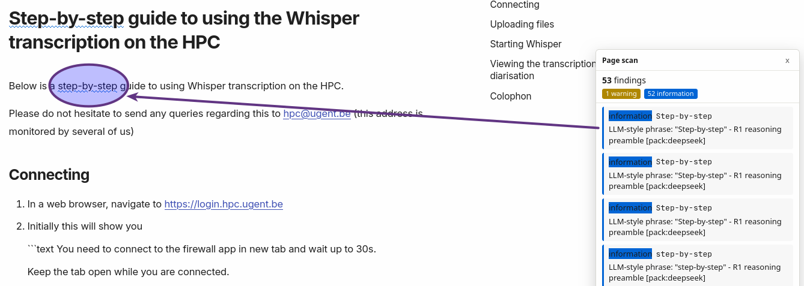

# Detecting slop

## Installing

* checkout github.com/mandakan/llm-slop-detector
* `npm run compile`

## Using

```bash
/repos/github.com/mandakan/llm-slop-detector$ npm run slop ~/repos/github.com/Oa8choo2/p17/docs/invisible.md 

> llm-slop-detector@0.10.1 slop
> node ./out/cli.js /home/user/repos/github.com/Oa8choo2/p17/docs/invisible.md

../../Oa8choo2/p17/docs/invisible.md:7:7  warn   LEFT-TO-RIGHT MARK (U+200E) - fix: delete [built-in]
../../Oa8choo2/p17/docs/invisible.md:18:7  warn   LEFT-TO-RIGHT MARK (U+200E) - fix: delete [built-in]
../../Oa8choo2/p17/docs/invisible.md:20:3  warn   LEFT-TO-RIGHT MARK (U+200E) - fix: delete [built-in]
../../Oa8choo2/p17/docs/invisible.md:26:17  warn   LEFT-TO-RIGHT MARK (U+200E) - fix: delete [built-in]

4 findings (4 warning)
```

Alternative (after install)

```bash
p17/docs$ sudo /usr/local/lib/node_modules/llm-slop-detector/out/cli.js . | tail -n 6 
terminal.md:25:24  info   RIGHT DOUBLE QUOTATION MARK (U+201D) - fix: "\"" [built-in]
terminal.md:37:22  info   RIGHT SINGLE QUOTATION MARK (U+2019) - fix: "'" [built-in]
terminal.md:42:18  info   RIGHT SINGLE QUOTATION MARK (U+2019) - fix: "'" [built-in]
terminal.md:47:26  info   RIGHT SINGLE QUOTATION MARK (U+2019) - fix: "'" [built-in]

108 findings (4 warning, 104 information)
```


## As a firefox / chrome add-on

[llm-slop-detector](https://addons.mozilla.org/en-US/firefox/addon/llm-slop-detector/)

Result:



