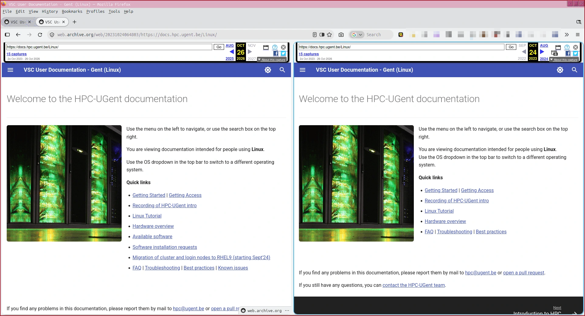

# What changed

How can you find out what changed on a website?

## Using internet archive

If the site is archived on a regular basis you can compare versions.

TODO: add info / file on how to automate archiving a website on regular basis

Use the [split-view feature of firefox][split] (available since Firefox 149
released on March 24, 2026)

## If the site is based on a git repo

* git-quick-stats
* palaniraja/whatchanged

## Online services

* Wachete

### List of references

[split]: https://support.mozilla.org/en-US/kb/split-view-firefox

